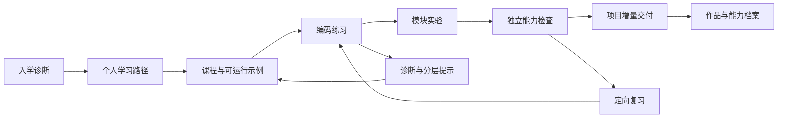

# Rust 开发工程师培养平台：产品设计方案

版本：设计稿 v1.0｜日期：2026-10-11｜项目现有名称：rust.path

本轮交付为方案文档，不包含页面、后端、题库或运行环境的具体实现。文中数量、时长、指标和配额均为规划值，需通过课程试学、运行器验证和负载测试校准。

配套文档：[课程与考核设计](./curriculum-design.md) · [技术架构与实施方案](./technical-design.md) · [实施路线图与完成台账](./implementation-plan.md)

## 1. 摘要与产品决策

建设一个公益导向的开源 Rust 学习网站，免费开放课程与学习功能，鼓励知识共享与社区共建。帮助学习者逐步形成 Rust 工程能力：能理解语言机制、独立编码、修复问题、设计服务、编写测试，并交付可运行、可维护的项目。平台围绕学习路径、课程、练习、实验、项目和能力档案组织；问答是理解检查的一种形式。

首条完整路线为 **Rust 通用基础 → CLI 工程 → 并发与异步 → Axum 后端 → 数据与安全 → 部署与维护**。目标用户首先是有基础编程经验、希望转向 Rust 的开发者。零基础用户通过独立预备课补齐编程、终端、Git、HTTP 和 SQL，避免主线同时承担计算机入门教育。

核心产品决策：

| 决策 | 方案 | 原因 |
|---|---|---|
| 培养结果 | 以编码与项目证据判断能力 | 阅读量和选择题正确率不能证明交付能力 |
| 课程规模 | 完整主线 8 阶段、24 模块、144 个教学单元 | 每模块包含讲解、实验和检查，而非堆积短问答 |
| 学习工作量 | 基准约 240 小时，建议预留至 320 小时 | 包含练习、项目、排错、复习；个人差异较大 |
| 训练体系 | 288 道基础题库规划、24 个模块实验、4 个项目交付 | 用多种证据验证同一知识点 |
| 在线运行 | R1 单文件、R2 Cargo 项目、R3 服务实验 | 逐步覆盖语言学习和工程训练 |
| 网站技术 | 复用现有 React，补充 Rust API 和独立运行服务 | 保留已有资产，并隔离不可信代码 |
| 辅导方式 | 固定分层提示为基础，AI 辅导作为可选能力 | 无 AI 也能完成学习闭环 |
| 内容生产 | Git 管理原创内容和测试，后台管理发布流程 | 课程与编译器、依赖、评测版本同步 |

## 2. 参与角色与责任

具体人员未指定，以下为职责，不虚构实际联系人。

| 角色 | 主要责任 | 交付物 |
|---|---|---|
| 产品负责人 | 用户范围、体验、优先级、上线取舍 | PRD、验收清单、试学报告 |
| 课程负责人 | 能力模型、课程顺序、原创教案、题目质量 | 课程包、项目规格、评分规程 |
| Rust 技术负责人 | 语言与库用法审核、参考解、兼容性 | 可编译课程样例、评测与版本基线 |
| 前端开发 | 课程阅读、编辑器、运行反馈、进度同步 | 学习工作台 |
| 后端开发 | 身份、课程发布、学习记录、评测协调 | 应用服务与数据模型 |
| 平台／安全负责人 | 执行隔离、资源管理、观测、恢复演练 | 运行器、基线测试与容量报告 |
| 导师／评审人 | 项目评审、反馈、复核与申诉 | 有证据的能力评价 |

小团队可兼任多个角色，但课程技术审核和不可信代码运行环境审核必须明确有人负责。

## 3. 背景、现状与参考来源

### 3.1 当前项目事实

已检查当前工作区。现有项目使用 React 18、TypeScript、Vite，包含 8 个基础主题和 28 个进阶主题，共 36 节短课。数据来自 `src/data/lessons.ts` 与 `src/data/advancedLessons.ts`。

现有价值：具备课程导航、心智模型、代码片段、选择题、开放题、复习与学习统计，以及 Java／Go 对比内容。

主要缺口：

| 当前情况 | 培养平台需要的能力 |
|---|---|
| 从所有权直接开始，基础工具链和语法覆盖不足 | 分层入口、完整先修路径、跳级诊断 |
| 部分课只有概念片段，很多示例依赖未定义上下文 | 每个示例标明完整可运行、局部片段或预期编译失败 |
| 修复题和补全题通过文本输入、自评处理 | 代码编辑、编译诊断、公开测试、受控评测 |
| 开放题自评 3 分以上计为掌握 | 自信度与技术掌握证据分开记录 |
| 完成状态取决于是否作答和手动标记 | 区分“已阅读”“完成训练”“通过能力检查” |
| 进度仅存在 localStorage | 账户同步、离线草稿、迁移与导出 |
| 基础代码执行器只有类型定义 | 实际运行服务、排队、取消、资源配额 |
| Agent Infra 比例较大 | 通用工程主线完整后，再进入方向选修 |
| 进阶内容主要按前一课建立先修关系 | 以真实知识依赖组织能力图谱 |

### 3.2 核心参考来源如何使用

| 来源 | 本次核实结果 | 在新课程中的角色 |
|---|---|---|
| [Rust Book 中文版](https://kaisery.github.io/trpl-zh-cn/) | 可访问；当前首页说明 Rust 2024 Edition，目录含异步编程章节 | 语言概念、术语、核心知识顺序的参考基线 |
| [Axum 文档](https://docs.rs/axum/latest/axum/) | 可访问；本次 `latest` 页面显示 0.8.9 | 框架 API、提取器、响应、中间件、状态与错误边界 |

课程以 Rust Book 中文版和 Axum 官方文档为核心底本。异步工程补充 [Tokio 官方教程](https://tokio.rs/tokio/tutorial)，持久化补充 [SQLx 文档](https://docs.rs/sqlx/latest/sqlx/)；其他工程知识按需引用对应工具的官方文档。

课程结构、产品流程、习题规格、项目和技术架构是本方案的原创设计建议。参考资料用于核对语言规则与 API，教学任务和工程项目围绕培养目标独立设计。

### 3.3 内容使用规则

采用“原创课程＋原创例题＋官方资料延伸阅读”的生产方式。讲解、图示、练习和项目围绕可验证的学习目标编写，直接复用的素材按其实际许可证处理。

所有来源记录作者、URL、访问日期、许可或待核实状态、适用版本、改编说明。来源按实际许可证逐项核对，不能用代码仓库的许可证自动覆盖第三方插图、译文等资产。授权未明确的正文不进入公开课程包或 AI 检索库。

## 4. 目标与衡量方式

### 4.1 用户完成主线后应具备的能力

能从一个业务需求出发，设计 Rust 类型与模块，完成带数据库和权限检查的 Axum 服务，编写测试、观察运行状态、解释失败路径，并交付可重现的部署过程。主线定位为独立完成中小型 Rust 后端任务的培养路径；不把结课等同于资深系统工程师或就业保证。

能力档案使用六个维度：语言与类型、资源与并发、业务建模、数据与接口、质量与排障、交付与维护。每个维度都能展开看到具体练习、检查与项目证据。

### 4.2 核心学习成效指标

**每周完成至少一个经有效验证的能力里程碑的活跃学习者数。**

里程碑指通过一个阶段检查或项目增量验收。浏览页面、手动勾选、AI 给出答案及重复刷同一道题，不单独算作新的里程碑。

### 4.3 首批试学指标

以下是待验证的产品目标，不是当前数据：

| 指标 | 定义 | 试学目标 |
|---|---|---|
| 首次成功 | 新学员在首次学习会话完成编辑并成功运行 | 中位耗时 ≤10 分钟 |
| 首模块闭环 | 开始 M01 的用户在 7 天内完成其训练与检查 | ≥60% |
| 次周有效回访 | 首次编码后第 8–14 天再次产生有效编码提交 | ≥40% |
| 学习迁移 | 看过提示后，在不同题目上独立通过对应技能检查 | ≥60% |
| 题目健康度 | 已发布可运行题按指定环境通过正反例验证 | 100% |
| 运行可靠性 | 合法任务未因平台故障中断；编译失败不算平台故障 | ≥99% |
| 评审时效 | 试学期人工项目评审完成时间 | 3 个工作日内 |

样本很小时同时报告人数和比例。学习时长只统计有效活动，不能把打开网页的时间当作投入。第一次 20–50 人试学优先发现障碍，暂不做复杂 A/B 实验。

## 5. 用户分层与价值

| 用户 | 主要障碍 | 入口与支持 | 目标产物 |
|---|---|---|---|
| 有 Java／Go／Python／JS 经验的开发者 | 迁移旧语言习惯，容易用 clone、unwrap 绕过理解 | 入学诊断、可折叠语言对比、借用与错误练习 | 可测试 CLI、异步程序、后端服务 |
| 看过 Rust 书但无法写项目的人 | 知识零散，缺少工程结构和反馈 | 能力诊断后补薄弱模块，从项目倒查课程 | 四个可解释的项目交付 |
| 计算机专业学生 | 工程工具与业务背景不足 | 预备课、任务拆分、可重置实验环境 | 从需求到测试和文档的完整作品 |
| 转型中的后端工程师 | 异步、数据库、部署经验无法迁移 | 基础挑战通过后跳级，强化 Axum 和生产问题 | 数据一致性、权限、监控和故障分析 |
| 导师／课程作者 | 难以观察学员真实进展，题库维护困难 | 课程版本、错误聚类、评审队列、题目分析 | 可维护的课程与有依据的反馈 |

主线不要求读者先学会 Java 或 Go。跨语言对比是可选补充；所有核心概念必须能只用 Rust 解释。

## 6. 完整产品方案

### 6.1 培养闭环



自由阅读不锁定；完成阶段的“能力徽章”才需要先修证据。经验用户可直接做诊断挑战，通过后跳过学习建议，不伪造已读状态。

### 6.2 信息架构与页面规格

| 页面 | 核心内容 | 主操作 | 验收重点 |
|---|---|---|---|
| 首页 `/` | 平台目标、路线、真实课程样例、项目成果 | 开始诊断／试学 | 不强制注册即可阅读和尝试基础示例 |
| 学习台 `/learn` | 继续上次任务、今日建议、待复习、项目进展 | 继续学习 | 显示具体下一步，而非只有总百分比 |
| 路线 `/tracks/:slug` | 阶段、能力目标、先修关系、时间与项目 | 进入模块／挑战跳级 | 明确已开放和规划中内容 |
| 课程 `/lessons/:id` | 正文、模型、示例、检查、延伸阅读 | 运行示例／进入练习 | 可以切换阅读与编码布局 |
| 练习 `/exercises/:id` | 题目、约束、编辑器、运行结果、提示 | 运行／提交评测 | 运行和计分提交含义不同 |
| 实验 `/labs/:id` | 多文件、环境状态、步骤、HTTP 请求、数据库种子 | 启动／停止／重置实验 | 环境和代码保存状态分开显示 |
| 项目 `/projects/:id` | 用户故事、里程碑、任务、测试契约、评分表 | 提交某里程碑 | 交付需求和评分标准事先可见 |
| 复习 `/review` | 到期技能、典型错误、变式题 | 开始 15 分钟复习 | 优先不同上下文的迁移题 |
| 档案 `/profile` | 六维能力、证据、作品、已验证版本 | 查看证据／导出 | 公开分享默认关闭 |
| 搜索 `/search` | 课程、术语、错误码、API、项目任务 | 跳转具体章节 | 能搜索 E0382、State 等中英文词 |
| 作者台 `/author` | 草稿、校验、预览、评审、发布历史 | 申请发布／回滚 | 发布不会覆盖已有提交对应版本 |
| 评审台 `/mentor` | 待评项目、测试证据、评分表、复审 | 反馈／要求补交 | 导师只能访问授权班级或项目 |

### 6.3 学习工作台布局

桌面建议采用可拖动分栏，而非同时堆满课程、聊天、图表和终端。

```text
顶栏：阶段 / 课程标题 / 环境版本 / 草稿保存状态
左侧：模块目录、先修提示、当前任务
中央：课程正文 ↔ 任务说明；支持专注阅读
右侧：代码编辑器、文件树；支持专注编码
底部：诊断 | 标准输出 | 测试 | HTTP | 运行状态
任务操作：运行公开样例 / 提交评测 / 获取提示 / 下一步
```

正文宽度适合长时间阅读；代码字体和缩进可调整。浅色与深色主题保留。状态同时用文字与图标表达，不仅靠颜色。所有动作有键盘入口，编辑器可跳出焦点；图示提供文字说明。

手机优先支持阅读、短题、复习、查看反馈，编辑器独立全屏。多文件实验明确提示建议桌面使用，草稿可跨设备继续。

### 6.4 一节课的标准体验

每节概念课含：真实问题、2–3 个可验证目标、先修提示、核心模型、正常示例、典型错误、随堂修改、工程关联、要点回顾、来源与版本。默认 15–25 分钟讲解，加 20–40 分钟练习；实验和检查另设工作量。

学习者先预测，再运行，再修改。遇到编译错误时同时看到原始诊断、代码定位和简短解释。错误不自动“修成答案”；提示分为定位知识点、解释约束、局部提示、参考方案四层。

参考解允许查看，但记录“参考后完成”；后续用新题验证独立迁移。以一次失败触发多条建议会干扰学习，默认只推荐一个最相关动作。

### 6.5 练习、实验和项目

练习包括预测、编译错误修复、函数实现、测试补全、接口建模、代码评审、并发排错、API 行为验证。问答题在基础题库中控制为少数，代码行为和工程交付为主。

实验比练习更接近工作任务，包含多文件、可重置状态和验收检查；项目要求读需求、自己拆任务，并在多个模块中持续演进。不能把一份填空式模板做完就描述为独立项目能力。

四个项目为：日志分析 CLI、受限并发任务执行器、带权限和数据库的团队任务 API、将任务 API 演进为可部署和可运维的服务。最后两个是连续演进的同一业务项目，明确区分开发与交付阶段，避免重复计算作品数。

完整课表、项目规格、评分与样例课见[课程设计](./curriculum-design.md)。

### 6.6 掌握度、复习与激励

技能状态使用“未验证 → 练习中 → 提示下通过 → 独立通过 → 跨场景验证”，额外标记“待复习”。一项技能的状态由具体证据驱动，而非不透明百分比。

独立通过要求在未查看该题答案的情况下完成对应检查；跨场景验证要求在后续项目或变式题中再次证明。使用提示不惩罚正常学习，能力档案如实标注辅助程度。

复习初始采用 1、3、7、14 天的建议间隔，按实际表现调整。它是可解释的初始规则，不宣称是最优学习算法。平台故障、队列等待和运行器超限配置问题不计入学习失败。

保留连续学习天数作为辅助反馈；工程能力名称不能仅按读了多少课升级。首版不做全站速度排名，避免鼓励复制和浅层刷题。

### 6.7 AI 辅导边界

AI 作为可选助教，读取当前允许公开的课程片段、用户主动提交的代码、公开测试反馈和明确选择的错误上下文。它提供解释、提问、提示和评审建议，并附来源章节。

隐藏测试、标准答案私有部分、其他学员提交、平台密钥都不进入模型上下文。AI 不直接授予毕业成绩；编译、测试和人工评分有明确的证据链。独立检查默认关闭 AI 提示，查阅文档可按考核规则允许。

启用第三方 AI 时先清楚告知传输哪些代码与文本；学习者可关闭。先做规则提示和错误码关联，再验证 AI 是否减少卡点，不把对话次数当作产品价值。

### 6.8 作者与内容维护流程

课程包由作者提交，经过结构校验、技术校验、教学审核、试学、发布五步。作者台展示失败示例、错误率、提示使用率、典型失败分类和反馈入口。

对于集中出现的错误，先区分知识点难、题意不清、测试过严和环境失效。问题题目可暂停计分、修订后发布新版本并重评受影响提交。重评保留历史成绩和原因，通知真正受影响的用户。

### 6.9 关键状态与故障体验

| 情况 | 页面行为 | 数据规则 |
|---|---|---|
| 未登录试学 | 可阅读与低配额运行，草稿保存在设备 | 注册后可导入，不自动授予历史成绩 |
| 正在排队 | 显示队列状态和取消入口，不编造倒计时 | 任务只创建一次 |
| 编译失败 | 定位行列，展示诊断与课程关联 | 记录为学习反馈 |
| 测试失败 | 展示公开测试差异、隐藏测试类别摘要 | 不泄露私有用例 |
| 平台失败 | 明确说明环境问题，可安全重试 | 不扣学习分、不重复扣配额 |
| 网络中断 | 保留草稿，重连后恢复任务状态 | 服务端已完成的评测仍可查询 |
| 额度用尽 | 告知下一次恢复时间，可继续阅读和下载项目 | 按用户实际时区展示 |
| 实验到期 | 提前提示、保存代码、关闭进程 | 临时数据库按说明回收 |
| 题目升级 | 展示当前版本和升级说明 | 已有提交仍绑定原题版本 |

## 7. 技术概要与假设

建议采用 React／TypeScript 学习界面、Axum 应用 API、PostgreSQL 数据库、对象存储和独立 Rust 执行工作池。第一版使用数据库持久队列，避免过早引入多种基础设施。公共课程构建为可缓存静态内容；私人学习数据走受权 API。

在线运行的编译期和执行期均视为不可信。运行节点与业务 API、业务数据库隔离。R3 使用独立实验数据与受控网络，学员程序不能接触平台生产库。技术细节、接口、表结构、配额、部署与成本公式见[技术方案](./technical-design.md)。

当前设计假设：开源、公益导向，课程与学习功能免费开放；中文优先；首批 20–50 名试学用户；个人自主学习优先；有编程经验为主；允许下载课程项目在本机继续。在线运行配额根据可用资源和公平使用原则设定，用于保障共享环境的稳定性。后续扩展围绕学习需求、社区贡献和维护能力规划。

## 8. 发布、迁移与验收

### 8.1 分阶段交付

| 阶段 | 相对工作周期估计 | 网站与内容范围 | 出口条件 |
|---|---|---|---|
| A：内容与运行验证 | 2–3 周 | 3 个代表课包、借用样例、Cargo 测试、Axum 实验的技术验证 | 样例能在锁定环境可靠运行，教学结构可用 |
| B：邀请制学习闭环 | 4–6 周 | M01–M06 共 36 单元、72 道题、6 个实验；账户、R1、进度、复习 | 新用户完成一次学习到独立检查闭环 |
| C：工程训练版 | 6–8 周 | M07–M18；R2、R3、P1–P3、数据库课程 | 项目能从模板到测试通过并接受评审 |
| D：完整主线版 | 4–6 周 | M19–M24、P4、安全与部署、能力档案、作者台完善 | 毕业交付可重现，评测、隔离与恢复达标 |
| E：方向扩展 | 主线验证后单独估算 | Agent、系统工具、WASM 等选修，导师班级 | 每条路线有独立项目和真实先修要求 |

上述总计约 16–23 周是具备专职产品／课程、前后端与平台能力的小团队估计，不是承诺。课程生产可与平台并行，但 144 单元的原创写作、测试设计和试学往往是关键路径。单人完成应按人员投入重新估算，不能沿用这个日历时间。

### 8.2 最小版本必须交付的完整体验

第一版即包含真实课程、可编辑与可运行代码、至少一种自动代码评测、分层提示、可恢复草稿、独立能力检查、复习与来源。只扩充选择题或增加一个聊天框不满足产品验收。

短期不做全功能云 IDE、任意 crate 安装、任意公网访问、实时多人协作、视频制作平台和复杂推荐算法。这些能力不妨碍课程培养目标，可在主线跑通后验证需求。

### 8.3 现有项目迁移

1. 盘点 36 节内容，将每个主题映射到新模块和稳定技能 ID；基础重复内容合并，Agent 内容移入选修。
2. 给示例补齐可运行上下文；局部片段显式标识；增加错误示例和测试，不自动把现有解释视为已审核教案。
3. 将题目从前端内联答案改为公开题面与受控评测包；历史开放题保留为反思题。
4. 导入 localStorage 时标记为 `legacy_self_reported`；保留阅读、作答、自评，不能迁移为自动验证成绩。
5. 用旧 ID 到新 ID 映射维持书签；合并或拆分课程时给出解释；旧页面短期只读可回退。
6. 逐模块发布，完成一次真实迁移验收后再切换默认入口。

### 8.4 上线验收清单

| 范畴 | 可检查的验收标准 |
|---|---|
| 教学 | 每个已发布模块都有目标、先修、实验、检查与版本来源 |
| 代码 | 正确解通过，已知错误解失败；预期编译失败题验证错误类别 |
| 体验 | 键盘能完成主要流程，断网恢复不丢草稿，反馈能定位代码 |
| 成绩 | 答案查看、自评、运行、正式提交、人工审核分别记录 |
| 可靠性 | 取消与重试不重复计分；工作节点中断可恢复；环境错误可辨别 |
| 隔离 | 编译／运行／LSP 都受限；无平台秘密暴露；跨用户访问测试通过 |
| 内容维护 | 草稿可预览、版本可回滚、坏题可暂停并追踪受影响提交 |
| 项目 | 需求、测试契约、评分表、补交和申诉路径完整 |

### 8.5 风险与待验证事项

最大的产品风险是“内容很多，仍不会做项目”；用早期 P1 项目完成率和迁移检查验证。最大的技术风险是 Rust 编译成本与多租户运行隔离；用三档代表工作负载测量后决定配额和基础设施。最大的维护风险是原创课程维护不足；每个课包必须有负责人和版本复测记录。

后续决策点包括：首批用户的编程背景、部署地区与延迟、可投入的课程与平台人力、是否配置人工项目评审、AI 是否启用。这些不阻碍本方案的设计，但会影响实施排期、资源安排和发布范围。
