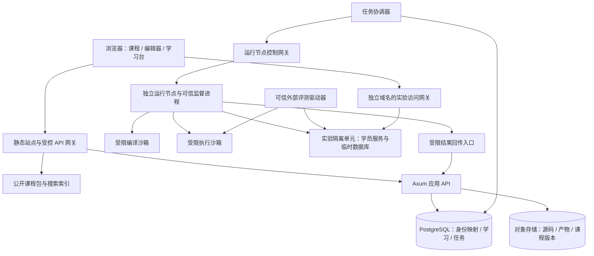
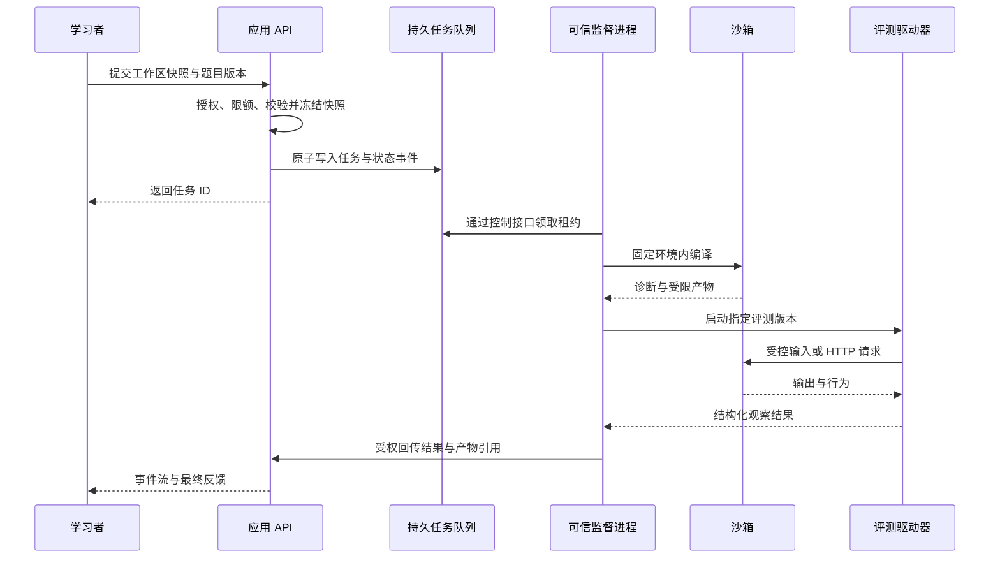

# Rust 开发工程师培养平台：技术架构与实施方案

版本：v1.0｜日期：2026-10-11｜状态：建议设计，未进行实现、压测或安全验证

关联：[产品方案](./PRD-rust-engineer-academy.md) · [课程设计](./curriculum-design.md) · [实施路线图与完成台账](./implementation-plan.md) · [前端开发规范](./frontend-development-standards.md) · [后端开发规范](./backend-development-standards.md)

## 1. 架构目标与关键决策

本项目为公益导向的开源学习平台，课程与学习功能免费开放。架构优先支持低门槛部署与可持续维护；运行配额用于资源保护和公平使用，容量与成本估算用于安排基础设施资源。

平台需要同时服务两类负载：课程与学习记录属于稳定的业务请求；学员代码的编译和执行属于高资源消耗、可能恶意且生命周期不确定的任务。两者必须有独立的运行边界。

| 决策 | 推荐方案 | 理由与代价 |
|---|---|---|
| 前端 | 保留 React＋TypeScript＋Vite | 现有项目可逐步迁移；不因增加课程立即整体更换框架 |
| 公共内容 | 构建期生成静态 HTML 与搜索索引，交互组件按需加载 | 阅读首屏与搜索可独立缓存；需要增加内容构建流程 |
| 应用后端 | Rust＋Axum＋Tokio，模块化单体 | 与教学主线一致，先控制系统规模 |
| 数据层 | PostgreSQL＋SQLx | 学习记录、版本和任务状态有事务约束；迁移需要管理 |
| 文件层 | S3 兼容对象存储 | 课程包、源码快照、日志、评测产物按版本存储 |
| 初始任务队列 | PostgreSQL 持久任务表＋租约＋后台协调器 | 减少基础设施；吞吐增长后再评估专用队列 |
| 在线编辑 | Monaco，首版提供基础编辑和编译诊断 | 后续补 rust-analyzer；编辑器本身不等于 Rust 编译器 |
| 运行服务 | 独立 Linux 工作池，隔离编译与运行 | 不可信代码不能在业务 API 进程或宿主机直接运行 |
| 公网多用户隔离 | 优先验证 gVisor，兼容性不足时评估 Firecracker | 需要原型测量；普通容器不作为唯一隔离边界 |
| 日志传输 | SSE 推送任务事件；WebSocket 留给 LSP 等双向会话 | 基础运行结果主要是单向流，无需所有连接都使用 WS |
| 身份 | 受维护的 OIDC 身份服务＋服务端 Session | 减少自建密码与找回流程，仍需正确处理回调和会话 |
| AI | 可选独立模块，平台核心流程不依赖它 | 控制费用、数据外传和不可重复评分 |

[Axum 官方文档](https://docs.rs/axum/latest/axum/)说明了与 Tokio、Tower 的组合方式；[SQLx 文档](https://docs.rs/sqlx/latest/sqlx/)提供异步 SQL、连接池与查询能力。这些支持上述技术选择，但整个平台架构是本方案的设计判断。

本次查阅 Axum `latest` 显示 0.8.9，SQLx `latest` 显示 0.9.0。二者只是独立文档快照，并不意味着已验证整个依赖组合。实施前通过兼容性样例锁定 rustc、Axum、Tokio、SQLx、Tower 和 rust-analyzer 的准确版本，保存 Cargo.lock 与镜像 digest。

## 2. 总体结构



图中的连接表示允许的业务路径，不代表任意网络互通。学员沙箱不能连接业务 API、平台数据库、宿主控制接口或对象存储管理接口。只有可信监督进程持有窄权限、短期任务凭据。

应用模块为：Identity、Catalog、Learning、Assessment、Workspace、Execution、Projects、Authoring。模块拥有自己的业务规则，通过稳定接口交互；首版一个应用部署即可。运行节点因信任边界和资源模型不同，单独部署。

## 3. 内容架构与发布流水线

### 3.1 内容与状态分离

课程来源遵循产品与课程方案：以 Rust Book 中文版、Axum 官方文档为核心，按工程主题补充相关工具的官方文档。内容包仅收录经过审核的来源引用与原创教学内容。

课程源文件存 Git，学习者数据存数据库。正文优先采用 Markdown＋结构化组件指令，经可信构建流程转换成清洗后的 HTML／内容 AST。可运行例子用 snippet ID 引用文件，不在正文和题库复制维护多份。

若以后采用 MDX，只有审核过的仓库代码能进入构建；不可把用户或任意作者在线输入的 JSX 直接编译执行。学员笔记使用受限 Markdown，过滤原始 HTML、危险 URL 与脚本。

课程包设计结构如下，属于未来目录约定，本轮不创建这些实现目录：

```text
content/tracks/rust-backend/track.yaml
content/modules/m05/module.yaml
content/lessons/m05-l03/lesson.md
content/lessons/m05-l03/meta.yaml
content/lessons/m05-l03/snippets/
content/exercises/borrow-first-token/public/
content/projects/task-service/spec.md
private-assessment/borrow-first-token/       # 独立私有包，不能进入站点资源
environments/rust-core/manifest.yaml
```

### 3.2 内容数据字段

| 实体 | 主要字段 |
|---|---|
| TrackVersion | track ID、version、模块顺序、能力目标、发布状态 |
| ModuleVersion | 先修技能、教学单元、项目关联、预计时长 |
| LessonVersion | lesson ID、version、content hash、目标、内容块、示例引用 |
| ExerciseVersion | 类型、技能、公开契约、可编辑范围、环境 ID、私有评测包引用 |
| SourceReference | 原 URL、作者、访问时间、上游 revision、许可状态、改编说明 |
| EnvironmentVersion | rustc、Edition、target、依赖锁、镜像 digest、资源档位 |
| AssessmentVersion | 驱动器、评分规程、测试集 hash、结果协议版本 |

“课程 ID”标识学习主题，“课程版本 ID”标识一次不可变发布。提交记录必须指向版本 ID，不能指向会自动改变的 `latest`。

### 3.3 发布流水线

内容提交 → schema 校验 → 先修图无环检查 → 来源与授权字段检查 → 示例运行 → 正确解与错误解评测 → 可访问性与链接检查 → 审核预览 → 发布不可变课程包 → 更新课程目录指针。

公开包不含参考解私有部分和隐藏测试。发布流程使用文件白名单，而非仅依赖隐藏目录名字。缓存键包含内容 hash；回滚只切换目录指针，不改历史提交。上游依赖升级在预发布环境批量回归，审核后发布新环境版本。

初版搜索用静态索引，包含标题、术语、错误码、标签、公开正文和 API 名称，提供中文分词或字符切分索引及 Rust token 精确匹配。内容规模或更新频率超过静态构建可承受范围后，再引入服务端搜索。

## 4. 前端与编辑器

### 4.1 页面与状态管理

拆分当前单一 App 的课程、练习、复习和统计职责。采用路由级组件、服务端数据缓存层、局部 UI 状态。学员成绩以服务端为准；浏览器保存的是草稿与待同步事件。

正文和静态样例可按模块缓存；用户私有反馈不进入公共 CDN。编辑器、图示和实验面板按需加载，避免所有课程首屏都下载云 IDE 资源。

### 4.2 工作区模型

每个工作区包含：模板版本、文件快照、可编辑文件集合、允许依赖集合、当前环境、最近运行及当前实验。保存源码不等于保存进程或数据库。

草稿保存在 IndexedDB；服务端用 workspace revision 乐观并发控制。多设备冲突保留两份并展示 diff，不悄悄以后保存的文本覆盖所有修改。运行时冻结快照，用户继续编辑不改变正在评测的代码。

Monaco 提供编辑界面；Rust 的语义补全与诊断分两步：首版按运行结果显示 rustc 的结构化诊断；后续按会话接入隔离运行的 rust-analyzer。不能把语法着色当成完整类型检查。[Monaco 官方入口](https://microsoft.github.io/monaco-editor/)

### 4.3 LSP 的特殊边界

rust-analyzer 可能调用 Cargo、处理宏或构建脚本，因此它也只能在受限工作区环境运行，不能直接打开生产服务目录。基础模式关闭用户自定义构建脚本／过程宏执行；高级实验只允许受控依赖，并将相关处理放进相同隔离体系。

LSP 使用双向 WebSocket 和 JSON-RPC，空闲回收；工作区与模型建立一一授权关系。限制文件数、文件大小、消息频率和诊断总量。LSP 断连不阻止保存与批量编译。

### 4.4 学习图示

初版用确定性 SVG／组件展示所有权、借用、栈帧、Future 状态和请求流水线，支持步骤播放和文字等价描述。只支持已审核教学样例；任意代码的内存可视化和调试器属于独立研发项目，不纳入首版承诺。

## 5. 在线运行：三档能力

| 档位 | 使用场景 | 提供能力 | 明确边界 |
|---|---|---|---|
| R1 单文件 | 基础语法、借用、函数练习 | check/run/test、stdin、stdout、stderr、格式化 | 固定模板与标准库为主，无自由网络和任意依赖 |
| R2 Cargo 工作区 | CLI、异步库、多模块项目 | 多文件、固定依赖、公开测试、Clippy、源码导出 | 不允许任意 Git 依赖、宿主路径依赖或 shell 命令 |
| R3 服务实验 | Axum、SQLx、HTTP 与事件 | 临时 HTTP 服务、受控请求面板、实验数据库、种子、重置 | 仅访问本实验服务，默认无公网出口 |

三档都在远端编译运行，浏览器负责编辑、反馈与受控预览。浏览器端 WASM 可作为未来部分纯计算样例的补充，不能假设它能替代原生 Cargo、进程、TCP 和数据库实验。

### 5.1 自建与外部 Playground 的边界

官方 Rust Playground 可作为“带代码打开”的辅助入口和架构参考。其仓库描述了 React/Axum 与容器结构，以及网络、内存和时间限制；本项目的在线执行能力需自行部署与验证，不能依赖公共实例保障运行容量和可用性。[Rust Playground 仓库](https://github.com/rust-lang/rust-playground)

建议自行维护有限功能运行服务。可以评估复用上游的部分代码，但需评估许可证、依赖、协议、资源控制与维护成本，不能简单嵌入 iframe 就宣称支持课程工作区和可信评测。

### 5.2 初始资源档位

下表是验证起点，未实测。编译和运行限制分开，避免把普通编译开销算成学员程序超时。排队超时也单独计算。

| 项目 | R1 | R2 | R3 |
|---|---:|---:|---:|
| 编译资源上限 | 2 vCPU / 2GiB | 2 vCPU / 4GiB | 2 vCPU / 4GiB |
| 编译墙钟上限 | 30s | 90s | 120s |
| 程序资源上限 | 1 vCPU / 256MiB | 1 vCPU / 512MiB | 应用 1 vCPU / 512MiB，数据库另预算 |
| 程序执行／会话上限 | 单次 5s | 单次 20s | 空闲 10min、单会话最长 30min |
| 可写磁盘总额 | 128MiB | 512MiB | 每实验 1GiB 起测 |
| 进程数上限 | 编译 128、执行 32 | 编译 128、执行 64 | 应用 64、辅助服务单独限制 |
| 结果输出上限 | 256KiB | 1MiB | 每会话日志 5MiB，响应另限 |
| 用户并发 | 1 运行 | 1 编译／运行 | 1 实验 |

实际需以代表依赖、链接器与数据库峰值调整。资源超过平台配置导致正确解失败，应修环境并重评；算法无界运行导致超限才属于学习反馈。

输入同样有限额：文件总数、单文件和压缩包大小、展开后大小、路径深度、stdin 长度。解包规范化路径并拒绝目录穿越、绝对路径、逃逸符号链接和特殊设备文件。

### 5.3 依赖与缓存

依赖由审核的环境模板预装，Cargo.lock 固定，运行时采用离线构建。只验证顶层 Cargo.toml 不够：还要控制 `.cargo/config`、路径依赖、Git 引用、编译器 wrapper、链接参数、构建脚本和过程宏。初版使用平台生成的 manifest/config，并限定编辑范围。

可信的依赖缓存只读挂载；用户源代码的 target 目录和编译产物不跨用户共享可写。公共缓存键至少含工具链、目标、依赖锁、features、编译配置和镜像版本。学员不得将产物写回公共缓存，避免缓存投毒。

预编译依赖只能减少部分等待，不承诺所有代码秒编译。热缓存、冷缓存和重依赖分别计量。故意放大宏展开、类型递归或链接负载的代码仍受编译超时、内存和 CPU 预算限制。

## 6. 不可信代码的隔离设计

### 6.1 信任边界

用户代码、编译器输出、测试 stdout、学员服务 HTTP 响应都不可信。编译阶段会执行构建脚本和过程宏，必须与运行阶段同等隔离。Rust 的内存安全不构成对宿主文件、网络、无限循环或资源消耗的保护。

生产建议使用专门 Linux 运行节点，容器隔离配合 gVisor，或经过验证的 microVM 方案。gVisor 文档说明它通过独立的应用内核减少宿主暴露面，同时存在兼容性和系统调用性能代价；资源和网络限制仍需另外配置。[gVisor 说明](https://gvisor.dev/docs/)；[安全模型](https://gvisor.dev/docs/architecture_guide/security/)

[Firecracker](https://firecracker-microvm.github.io/)作为 microVM 备选，适用于需要不同兼容性／隔离边界的情况，但会增加镜像、网络、快照和宿主配置工作。两者通过同一组编译、线程、文件、网络、数据库和取消测试后选择，不凭名称宣称绝对安全。

### 6.2 强制约束

沙箱以非 root 运行，禁用新增权限，删除不必要 capability，配置宿主和运行时适配的 seccomp／LSM 策略、PID 与 mount 隔离、只读根文件系统、受限临时目录、CPU／内存／进程／磁盘／输出限制。

不挂载 Docker socket、宿主工作目录、SSH key、云服务凭据或平台数据库密码。宿主运行代理权限最小化；其管理接口只能从控制平面访问。即使代理需要调用运行时，也不能把这项权限转交给学员进程。

沙箱默认断网。R3 的网络由监督进程或基础设施预建，仅允许指定实验服务和数据库；拒绝访问宿主、其他实验、内网控制面、云元数据和公网。控制不只检查用户输入 URL，还要落实到出口网络策略及代理解析结果。

执行结束、超时或取消时终止整个沙箱与进程树，回收文件、数据库、网络和预览令牌。只删除某个主进程 PID 不足以保证子进程已结束。清理失败进入隔离和重试队列，不能重新发给另一用户。

### 6.3 Windows 开发与 Linux 运行

当前工作区在 Windows。前端和业务开发可保持原环境；不可信运行器应使用隔离的 Linux 虚拟机／专用测试主机验证，不能用本机 PowerShell 直接执行上传的 Rust 程序。gVisor 和 Firecracker 的宿主条件、虚拟化能力及系统调用兼容性需在技术验证阶段确认。

## 7. 编译、评测与成绩可信度

### 7.1 执行流程



监督进程身份可信只说明消息来源，不自动说明学员同进程测试报告是真的。具体评测方式必须与任务风险匹配。

### 7.2 两类评测

**练习级评测**：运行公开 cargo tests 和课程私有测试，反馈函数行为、编译诊断和规范问题。测试文件不发给浏览器，但若测试与学员代码在同一进程或可读文件系统内，不能保证测试内容保密和结果完全不可伪造。其定位是学习反馈。

**能力检查与项目评测**：由学员沙箱外的可信驱动器生成输入、计算预期值并观察行为；CLI 用标准流协议，API 用 HTTP，数据库最终状态由独立有权限的驱动器检查。对纯库任务可构建受控调用桥，评分在沙箱外完成；仍不能阻止学员代码观察本次输入，因此加上动态变式、限次评测和人工解释验证。

绝不通过解析用户 stdout 中的“passed”字样授予成绩。运行原始结果、评测 verdict 和最终人工评分分开保存。隐藏测试不显示具体数据，但反馈其失败类别，例如“Unicode 边界未通过”，保证学习者有修复方向。

### 7.3 编译诊断与反馈

Rust 编译器／Cargo 使用机器可读诊断，提取 severity、错误码、message、文件、行列、建议及原始文本。平台同时保留简明中文解释与原始信息，不用 AI 翻译覆盖原诊断。

错误码关联课程技能仅作为启发：同一个 E0277 可能来自 trait、Send 或其他约束，必须结合具体诊断和题目上下文。课程规则不能根据错误码独断判断薄弱能力。

格式化和 Clippy 独立执行；严重程度由课包指定，不把所有风格 lint 都设为新手课程硬失败。性能测试采用固定环境、重复样本和宽容区间；共享节点上易波动的微基准不用于决定性成绩。

## 8. 任务调度、状态与事件

任务状态：`queued → preparing → compiling → running → grading → terminal`。终态包含 `succeeded`、`compile_error`、`test_failed`、`runtime_error`、`timed_out`、`resource_limited`、`cancelled`、`infrastructure_error`、`expired`。格式化等任务可跳过无关阶段，但状态迁移必须合法。

生命周期还保存 `cancel_requested_at`，因为“请求取消”和“沙箱已终止”不是一回事。前端先显示取消中，清理完成后才显示已取消；与完成竞争时按原子终态规则决定，不能同时生成两个最终成绩。

### 8.1 队列语义

首版任务表使用短事务领取、租约、心跳和 `FOR UPDATE SKIP LOCKED`。领取后释放数据库事务，不在编译期间持有行锁。每次重领增加 generation／fencing token，过期 worker 的结果不能覆盖新一轮任务。

任务创建与队列状态同事务落库。未来使用外部消息队列时采用 outbox 发布，避免业务已记录而任务未投递。系统采用至少一次执行设计，通过幂等键、终态条件更新和唯一成绩事件避免重复扣额与重复记分，不承诺全链路 exactly-once。

基础设施故障可有限重试并记录原因；用户编译失败、测试失败不自动重试。工作节点失联先核对／回收旧沙箱，避免两个长寿命实验同时运行；短任务允许重复计算，但只接受有效租约的一次结果。

### 8.2 公平性与背压

按用户设置最大在途任务和配额，分离短运行、正式评测与长实验容量，长实验不能耗尽全部编译槽。超过全局容量时排队，有明确超时和取消；过载时返回可重试的限流响应，拒绝无限积压。

配额先预留，结束后按策略结算；因平台故障失败释放预留额度。前端禁用重复按钮只是体验措施，服务端必须用幂等键处理双击和网络重发。

### 8.3 SSE 事件

每个事件含 run ID、单调 seq、type、time、phase、payload。类型包括状态变更、诊断、输出块、测试摘要和终态。支持 Last-Event-ID 重连；事件保留过期后返回快照和“早期输出已过期”标志。

stdout/stderr 输出限量并分块，不能每打印一个字符就新增一条数据库记录。终态必须持久化；输出大块存对象存储并保存索引。代理禁用该路由的缓冲并设置适当心跳、超时，掉线后客户端可用状态查询降级。

## 9. R3 服务与数据库实验

每个实验有独立的应用沙箱、临时数据库或专用隔离数据库实例、种子和网络策略。公开多用户版本优先使用实验独享的临时数据库服务；共享数据库仅靠 schema 不是足够的强隔离方案。

如果邀请制阶段临时采用共享实验数据库宿主，需独立 database、最小权限角色、连接限制和明确负载上限；不得授予超级用户、扩展安装、宿主文件或其他实验访问能力。该选项需要专门验证并明确只用于受控试学，不能接入平台生产库。

实验网络允许应用访问自己的数据库及固定模拟服务。学员持有的只是临时实验凭据，不是平台数据凭据。可信评测驱动器使用独立只读／受控核验身份检查状态，避免学员篡改评测结果。

“保存代码”“保存实验数据快照”“停止实验”是三个动作。初版默认只持久化源码；需要保留数据库数据的课包显式提供快照，并显示过期策略。重置实验前保留代码版本，告知数据将回到种子状态。

### 9.1 HTTP 请求与预览

基础 API 实验先使用站内请求面板，按文本或结构化 JSON 展示响应，避免将任意返回内容注入平台 DOM。需要浏览器页面预览时使用独立可注册域，不能共享主站 Cookie 域。

预览网关按实验 ID 和用户会话授权，映射已分配的内部端口，不接受任意上游地址。令牌短期、可撤销，不把长期凭据写在 URL。过滤响应头、限制 body、禁止开放代理与任意跳转；iframe 使用最小 sandbox 权限。SSE/WS 预览根据课包单独允许。

## 10. 数据模型

| 表／聚合 | 关键字段与约束 |
|---|---|
| users | ID、OIDC issuer+subject 唯一、昵称、时区、状态 |
| enrollments | user、track version、目标、起始日期 |
| content_versions | stable ID、version、hash、status、source refs；发布后不可变 |
| skills / skill_edges | 技能定义、先修边；发布校验防循环 |
| lesson_progress | user、lesson version、read/practiced/validated 状态、时间 |
| workspaces | owner、template version、revision、最新快照引用 |
| workspace_snapshots | workspace、revision、source hash、文件清单、对象地址 |
| attempts | user、exercise version、snapshot、mode、assistance、created_at |
| runs | attempt、environment version、status、lease、generation、deadline、quota |
| run_events | run、seq、event type、payload／chunk ref；run+seq 唯一 |
| assessment_results | attempt、assessment version、verdict、rubric、evidence refs |
| skill_evidence | user、skill、来源 attempt／review、等级、有效性、版本 |
| review_schedule | user、skill、next_due、最近证据、规则版本 |
| project_submissions | user、project version、milestone、snapshot、报告 |
| mentor_reviews | submission、reviewer、rubric、反馈、复核状态 |
| lab_sessions | owner、环境、网络分配、lease、expires_at、清理状态 |
| source_references | URL、作者、revision、许可核验、用途 |
| audit_events | actor、action、resource、时间、reason，不记录秘密 |

用户当前技能状态是证据的派生视图，保留原始记录以便规则升级后重算。自主练习和正式检查分开；旧 localStorage 导入标记自报来源，不进入权威评测记录。

数据以 UTC 保存，按账户时区计算学习日和显示日期。默认时区由用户设备建议，并允许修改。跨时区或夏令时不能用“减去固定 24 小时”判断昨天。

### 10.1 保留与删除建议

初始建议：运行输出 7 天、非计分中间产物 24 小时、已保存工作区直到用户删除、正式项目证据保留至用户删除或课程约定期限。实验数据库到期即清理，备份另设 30 天轮转示例策略。

这些期限是产品建议，发布前明确告知并确定适用政策。删除用户数据需覆盖源快照、对象存储、搜索索引、公开分享和备份到期机制；不要承诺能即时删除已经封存的所有备份而没有具体实现。

## 11. API 契约草案

接口使用 `/api/v1`，OpenAPI 描述契约，前端类型由契约生成。以下定义资源和行为，不是本轮实现代码。

| 方法与路径 | 用途 | 关键行为 |
|---|---|---|
| GET `/tracks/:id` | 路线和已发布版本 | 返回能力和开放状态 |
| GET `/lessons/:id?version=...` | 课程公开数据 | 不含私有评测与答案 |
| POST `/workspaces` | 从模板建立工作区 | 检查用户权限与容量 |
| PUT `/workspaces/:id` | 保存草稿 | revision 不符返回冲突，不覆盖 |
| POST `/runs` | 检查／运行公开任务 | 服务端冻结快照和环境 |
| POST `/submissions` | 正式提交评测 | 绑定题目和评测版本，返回 202 与 ID |
| GET `/runs/:id` | 查询快照与最终结果 | 逐对象检查 owner／导师授权 |
| GET `/runs/:id/events` | SSE 输出 | 可重连、限速、鉴权 |
| POST `/runs/:id/cancel` | 请求取消 | 幂等，不能取消别人的任务 |
| POST `/labs` | 创建 R3 实验 | 配额和 TTL，返回会话与受控入口 |
| POST `/labs/:id/reset` | 回到种子环境 | 受权、可审计、保留代码快照 |
| DELETE `/labs/:id` | 停止并回收 | 结束态可重复调用 |
| POST `/learning-events` | 记录阅读／反思等 | 服务端不接受客户端自报“测试通过” |
| GET `/me/skills` | 技能与证据 | 区分独立、辅助、自报 |
| POST `/projects/:id/submissions` | 项目提交 | 绑定里程碑和评分规程 |
| POST `/author/releases` | 发布已审核内容 | 角色授权与构建校验，审计 |

创建任务的请求只接受 workspace revision、题目版本、固定动作枚举、stdin 等有限字段；不接受 shell 命令、任意镜像名、任意挂载路径和环境变量字典。使用 `Idempotency-Key` 防重建。

错误响应含稳定 code、用户可读 message、request ID、可选字段错误和 retryable；不能直接向用户暴露 SQL、宿主路径或内部凭据。对不可见资源统一采用约定的 404 策略，降低对象枚举。

## 12. 身份、授权与 AI

OIDC 使用授权码流程与 PKCE，校验 state、nonce 和固定回调地址。登录后用 HttpOnly、Secure、适当 SameSite 的 Session Cookie；变更请求校验 CSRF／Origin，不把长期访问令牌放在 localStorage。登出和权限变化能够撤销会话。

角色分为 learner、mentor、author、admin。导师仅访问分配给他的学生／班级；作者能编辑课包，不能默认阅读所有学生私有源码。运行、下载产物、SSE、预览和 LSP 均进行对象级授权，不能只在课程列表页鉴权。

AI 模块从已获许可、已发布的公开内容建立检索索引。请求携带课程版本和最小上下文，回答标注引用。用户代码与检索文本是数据，不能借其中的指令改变系统规则或触发工具操作。

模型无运行节点控制权限，不读取隐藏测试。建议修复与真实评测分开；若提供“应用建议”按钮，先显示 diff 并保留原版本。模型失败或额度用尽时，课程、提示、编译与正式评测仍然可用。

## 13. 部署与运行维护

### 13.1 初始部署形态

邀请制阶段：静态站点／CDN、1 个应用 API 部署、PostgreSQL、对象存储、协调器、独立运行节点。协调器可以与业务部署共享发行版本，但运行节点保持隔离。无需初期就引入 Kubernetes、消息总线和大量微服务。

公网正式版：业务 API 冗余实例、数据库备份与恢复、至少可替换的运行节点池、单独运行控制网段与实验预览域。部署环境需按地区、网络、可用资源与维护预算另行评估，本方案尚未确定具体环境。

后续按运行节点规模、实验生命周期和团队运维能力评估 Kubernetes Jobs／RuntimeClass 或专用调度器。Kubernetes Namespace 是组织边界，不能单独代替对恶意代码的隔离。

### 13.2 观测指标

学习侧观察首次运行成功时间、知识点失败类别、提示使用后迁移率、阶段通过率。运行侧观察排队时间、冷／热编译时长、缓存命中、CPU 秒、峰值内存、超时、OOM、清理失败和各环境错误率。

所有任务贯穿 request ID、run ID、attempt ID、environment version。日志默认不采集完整学员代码或输入，代码另按权限存储。报警基于平台故障与资源压力，不能因为学生正常编译错误触发运维报警。

### 13.3 服务目标与恢复

试学目标：课程 API 在标定负载下 p95 ≤300ms；R1 热环境端到端 p95 ≤8s，其中排队 p95 ≤3s；平台原因失败率 <1%。这些是目标，冷编译和复杂依赖单独报告，不纳入同一承诺。

公网阶段建议按月衡量应用可用性 99.5%，并根据预算上调。初始恢复目标建议数据库 RPO ≤24h、RTO ≤4h；正式成绩场景若需要更严目标，应启用持续归档等机制并验证成本。课程可用性、执行可用性和成绩持久性分别观测。

备份必须做恢复演练，不能只检查备份任务成功。工作节点可丢弃重建；权威成绩和任务状态在业务存储恢复，不依赖某台运行器本地磁盘。

## 14. 容量与成本估算

以下为计算方法与假设样例，不是已测容量，也不是云价格报价。

假设 200 DAU，每人每天 20 次运行，即 4,000 次／日；峰值 10 分钟内发生全天 10%，到达率约 400/600 = 0.67 次／秒。若平均占用执行槽 8 秒，平均并发需求约 5.4 槽；按目标 60% 利用率约需 9 槽。实际 p95 和冷编译会改变结果，要用队列压测验证。

如果峰值时每个编译槽都预留 2 vCPU／2GiB，9 槽仅预留量就约 18 vCPU／18GiB，还没包含业务服务、缓存和 R3。不能用“平均只有几秒”就给所有用户配一台低配主机。

按样例平均 CPU 消耗 6 CPU 秒／次，月运行 CPU 约为 `4000 × 30 × 6 / 3600 = 200 CPU 小时`。预留机器、内存、编译缓存、闲置容量和实验存活时间会使账单远高于只计算有效 CPU 的数字。

若 100 人每天各使用 30 分钟 R3、每实验应用和数据库合计预留 1GiB，则月实验消耗约 1,500 GiB 小时。可见实验空闲回收、数据库复位和预约容量比压缩静态页面更影响成本。

月成本公式：基础业务主机与数据库＋运行节点或 CPU／内存时长＋磁盘与对象存储＋网络＋身份服务＋可选 AI＋备份监控＋人工课程维护与评审。AI 单独按输入／输出 token、检索和调用次数计算，不混入基础课程可用性的必需成本。

获得实际价格前，先测 R1、R2、R3 的冷／热耗时、峰值内存和失败率，再代入所选地区供应商报价。首批 20–50 人试学与 200 DAU 容量示例是两个不同阶段，不能混用预算。

## 15. 验证与测试计划

| 维度 | 必须验证的场景 |
|---|---|
| 内容 | 示例可运行、失败例命中目标、正确解通过、错误解被拒绝、先修无环 |
| 学习流程 | 注册／匿名导入、断网草稿、冲突保存、提示与独立成绩分离 |
| 接口 | 对象级授权、幂等、输入限额、版本失效、CSRF、会话撤销 |
| 队列 | 双击、断线重发、租约到期、worker 崩溃、结果晚到、重复回传 |
| 沙箱 | 无限循环、内存／进程／磁盘耗尽、超大输出、子进程、编译期恶意负载 |
| 文件与网络 | 路径穿越、压缩包膨胀、symlink 逃逸、云元数据、跨实验访问 |
| 评测 | 伪造 stdout、修改可见测试、提前退出、私有结果泄露、错误解误通过 |
| 实验 | 数据库越权、预览越权、TTL 到期、重置竞争、清理失败 |
| 兼容性 | 固定 Rust/依赖组合、Unicode、Chrome/Edge/Firefox、键盘操作 |
| 运维 | 正确解负载测试、备份恢复、坏课程回滚、坏环境下线 |

安全与压力验证在专用隔离测试环境开展，不针对公共 Rust Playground 或其他第三方基础设施发起破坏性测试。上线阻断项是跨用户数据暴露、宿主访问、无法回收失控任务、成绩可被显然伪造和权威记录丢失。

## 16. 从现有原型迁移的工作包

| 工作包 | 核心工作 | 依赖与完成标准 |
|---|---|---|
| W1 内容建模 | 新课程 schema、36 节内容映射、来源台账 | 三种代表课包通过结构与教学审核 |
| W2 页面拆分 | 路由、阅读、练习、项目、复习组件 | 保留旧路径、可访问性通过 |
| W3 数据与身份 | 用户、进度、草稿、导入与导出 | 历史自评分来源不丢失、不冒充评测 |
| W4 运行验证 | R1、R2、R3 各一套受控环境原型 | 隔离、兼容性、冷／热成本测出 |
| W5 任务执行 | 快照、队列、状态机、事件、取消 | 重试不重复计分，失联可清理 |
| W6 自动评测 | 公开测试、外部驱动、成绩证据 | 正反例和伪造输出场景验证 |
| W7 项目与评审 | 里程碑、评分表、补交、申诉 | P1–P3 可完整验收 |
| W8 内容发布 | 预览、审核、版本、回滚、监控 | 新课上线不破坏历史记录 |
| W9 完整主线 | M19–M24、P4、运行手册与恢复 | 试学完成、公开发布门槛通过 |

W1 与 W4 可在后续实施期并行推进；W5 依赖 W3/W4 的契约；W6 依赖课包规范与任务执行；W7 依赖可用评测。这里描述工作依赖，不在本轮执行这些开发任务。

优先验证四个问题：借用样例能否清晰教学；真实 Cargo 项目能否在预算内运行；Axum＋数据库环境能否可靠隔离并回收；陌生变式和项目评审能否区分看过答案与真正掌握。它们通过之后，再扩大题库和页面功能。
